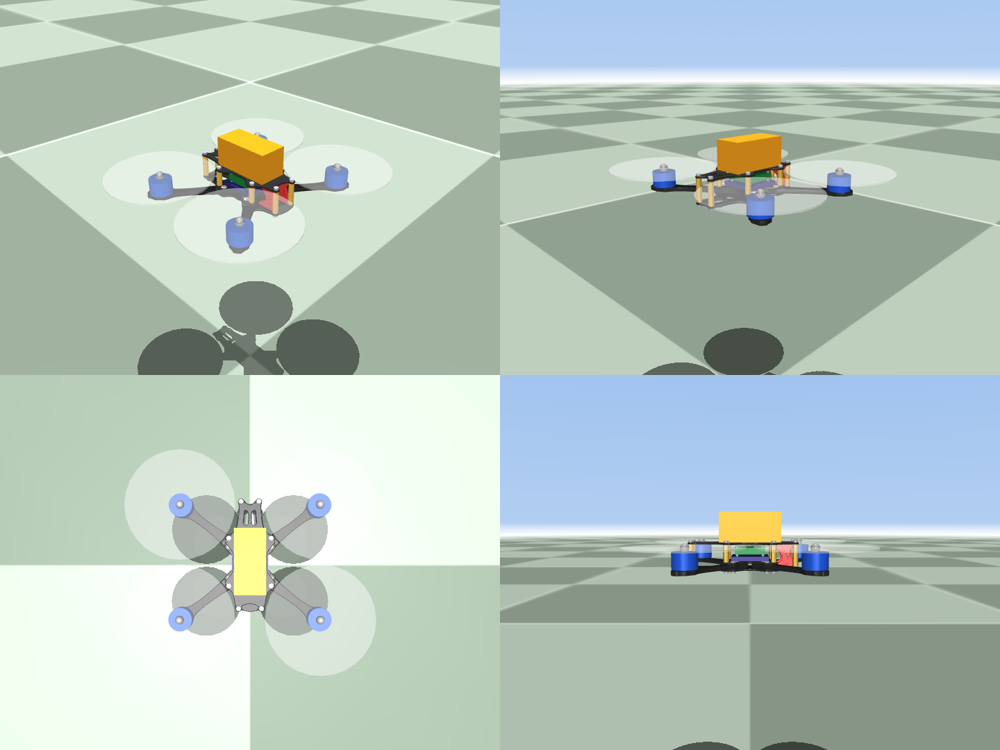

# drone_5inch

Mô hình MuJoCo của drone FPV 5 inch thật, dùng để thử bộ điều khiển và train RL (PPO) bay đua qua cổng trước khi bay ngoài đời.



## Thông số chính

| | |
|---|---|
| Khung | Khung tấm đặc tự thiết kế, in PETG-CF 100%: tấm đáy 8 mm, tấm nóc 4.5 mm, 8 cọc M3 20 mm ([KHUNG_DAC.md](description/KHUNG_DAC.md)) |
| Motor | DYS Samguk Wei 2207 2600KV ×4 |
| Cánh | HQ 5146 (5.1 inch, 3 lá) |
| Pin | 4S 1300 mAh |
| FC / ESC | MicoAir743v2 (PX4 1.17) / AM32 50A 4-in-1 |
| Khối lượng | 525 g (chi tiết từng linh kiện: [THONG_SO.md](description/THONG_SO.md)) |
| Lực đẩy max | 10.75 N mỗi motor (bảng đo Tyto, 4S), tỉ lệ lực đẩy / trọng lượng 8.3 |
| Hệ số yaw k | 0.0123 m |
| Vị trí motor | (±67.4, ±82) mm, đánh số theo PX4 Quad X |

Hệ trục: **X** = mũi, **Y** = trái, **Z** = lên. Gốc ở giữa 4 motor.

| Motor | Vị trí | Chiều quay | `gear` mô-men z |
|---|---|---|---|
| M1 | trước phải | ngược chiều kim đồng hồ | −k |
| M2 | sau trái | ngược chiều kim đồng hồ | −k |
| M3 | trước trái | thuận chiều kim đồng hồ | +k |
| M4 | sau phải | thuận chiều kim đồng hồ | +k |

Lệnh của mỗi motor (`ctrl`) là **lực đẩy tính bằng newton**, từ 0 đến 10.75.

## Cấu trúc

```
drone_5inch/
├── description/                MÔ TẢ ROBOT
│   ├── mjcf/
│   │   ├── drone_khung_dac.xml     drone khung tấm đặc (đang dùng), cánh có va chạm
│   │   ├── scene_khung_dac.xml     sàn + trời + đèn + drone khung đặc   <- mở file này để xem
│   │   ├── race_dong_dac.xml       cảnh đua: drone + 8 cổng dời được (tự sinh, môi trường RL dùng)
│   │   ├── drone.xml, scene.xml    khung cũ 9 chi tiết (giữ để so sánh)
│   │   └── race_*.xml              các đường đua mẫu
│   ├── meshes/                 STL: 4 file khung đặc (mm, tư thế in) + 9 chi tiết khung cũ (m)
│   ├── tracks/make_track.py    sinh đường đua 8 cổng ngẫu nhiên trong vùng 4 × 4 × 1.5 m
│   ├── THONG_SO.md             khối lượng, kích thước, motor, chiều quay
│   └── KHUNG_DAC.md            danh sách in + cọc + ốc để lắp khung đặc
├── controllers/
│   └── pid_controller.py       bộ điều khiển cổ điển (vị trí -> tư thế -> mixer)
├── envs/
│   ├── sensors.py              cảm biến FC (BMI088, SPL06, QMC5883L): nhiễu, lệch gốc, rung, lọc, trễ
│   ├── mocap.py                mocap tự làm (4 camera Pi, sai số ~2 cm, có trễ)
│   ├── estimator.py, nhanh.py  bộ ước lượng kiểu EKF2: IMU + áp kế + mocap, bù trễ
│   ├── hover_env.py            bài RL 1: giữ vị trí
│   ├── race_env.py             bài RL 2: đua qua 8 cổng
│   └── race_jax.py             bản GPU (JAX) của môi trường đua, thử nghiệm
├── train/
│   ├── train_hover.py
│   └── train_race.py           PPO, nhiều tiến trình CPU + GPU học
├── rviz/                       cầu nối mô phỏng -> RViz 2 (ROS 2 Humble)
├── checkpoints/                policy đã train (*.pt) + log
└── media/                      ảnh, GIF, video
```

## Chạy

```bash
PY=~/RL/thamkhao/lsy_drone_racing/.pixi/envs/gpu/bin/python

# xem mô hình, tự kéo 4 thanh m1..m4 trong bảng Control
$PY -m mujoco.viewer --mjcf=$HOME/RL/drone_5inch/description/mjcf/scene_khung_dac.xml

# bộ điều khiển cổ điển: bài thử / cửa sổ đẩy bằng chuột / quay GIF
$PY controllers/pid_controller.py
$PY controllers/pid_controller.py --xem

# thử cảm biến: so số đo với giá trị thật -> media/cam_bien_thu.png
$PY envs/sensors.py
```

## RL bài 1: hover (envs/hover_env.py, train/train_hover.py)

Mạng neuron (22 -> 64 -> 64 -> 4) xuất thẳng lệnh 4 motor ở 100 Hz, nhận quyền ở trạng thái ngẫu nhiên
(lệch ±0.5 m, nghiêng ±30°, yaw bất kỳ, trôi ±0.5 m/s).

```bash
$PY train/train_hover.py            # train 20M bước, khoảng 21 phút
$PY train/train_hover.py --test     # 100 lần nhận quyền
```

Kết quả `checkpoints/hover.pt`: 99/100 lần giữ được trong 5 cm, vào trong 5 cm sau 0.85 s.

## RL bài 2: đua qua 8 cổng (envs/race_env.py, train/train_race.py)

- **Đầu ra của policy:** lực đẩy tổng + tốc độ xoay 3 trục (giống lệnh gửi cho PX4), qua bộ lọc 15 Hz,
  rồi vào vòng điều khiển tốc độ xoay PX4 mô phỏng ở 500 Hz. Policy chạy 100 Hz.
- **Đầu vào:** chỉ những gì FC thật biết: vận tốc, tư thế, gyro, độ cao từ bộ ước lượng (IMU + áp kế + mocap),
  lệnh bước trước, vị trí và hướng 2 cổng tiếp theo. Không GPS, không la bàn.
- **Đường đua:** 8 cổng ngẫu nhiên (lòng 0.7 m) trong vùng 4 × 4 × 1.5 m, có 1 khúc cua gắt. Train trên kho 2000 map,
  chấm trên map thi riêng. Mỗi ván xoay / lật gương cả map và đổi hướng mũi lúc xuất phát.
- **Ngẫu nhiên hoá vật lý mỗi ván:** lực đẩy ×0.80–1.05, từng motor lệch ±3 %, lực cản tuyến tính + bình phương.
- **Va chạm:** thân, pin và vùng cánh quét (bán kính 66.5 mm) chạm cổng hoặc sàn = đâm.
- **Thưởng:** tiến gần cổng, qua cổng, về đích; phạt đâm, phạt tốc độ xoay lớn và lệnh giật.

```bash
$PY train/train_race.py                    # train từ đầu
$PY train/train_race.py --tiep             # train tiếp từ checkpoints/race_last.pt
$PY train/train_race.py --tinh_chinh checkpoints/race_best_khung_cu.pt   # train tiếp từ policy có sẵn
$PY train/train_race.py --test             # chấm map thi bằng race_best.pt
$PY train/train_race.py --gif              # -> media/race.gif
```

Kết quả `checkpoints/race_best.pt` (khung đặc, sau 100M bước tinh chỉnh từ policy khung cũ, 5.3 giờ trên GTX 1660 Ti):

| | |
|---|---|
| Về đích (100 lượt: 20 map thi × 5) | 69 % |
| Thời gian 1 vòng 8 cổng | 3.5–4.6 s, trung bình khoảng 4.0 s |
| Tốc độ lớn nhất | khoảng 6.5 m/s |
| Tốc độ xoay roll/pitch (RMS) | khoảng 6.6 rad/s |

Các lượt hỏng đều là đâm cổng, phần lớn ở cổng 1–2 (ngay sau cất cánh). Log các lần train: `checkpoints/race_log*.txt`.

Video: [media/demo_khung_dac.mp4](media/demo_khung_dac.mp4), bản chậm 3 lần [media/demo_khung_dac_cham.mp4](media/demo_khung_dac_cham.mp4).

## Xem trên RViz 2

```bash
rviz/chay.sh                          # bay lần lượt 20 map thi, thời gian thật
rviz/chay.sh --map 0,3,5 --cham 3     # chọn map, chậm 3 lần
rviz/chay.sh --ckpt checkpoints/race_best_khung_cu.pt
```

Hiện cổng (vàng = cổng đang nhắm, xanh = đã qua), vệt bay tô màu theo tốc độ (tím chậm -> vàng nhanh),
quỹ đạo ước lượng (hồng), quỹ đạo thật (trắng, bật trong panel), drone bằng mesh khung thật, mũi tên vận tốc.
Topic: `/dua/markers`, `/dua/path`, `/dua/path_uoc`, TF `world -> drone`.

## Chưa có trong mô hình
- Camera, VTX, receiver.
- Hiệu ứng con quay của cánh đang quay, gió.
- Khung trong mô phỏng cứng tuyệt đối (khung thật có rung).
